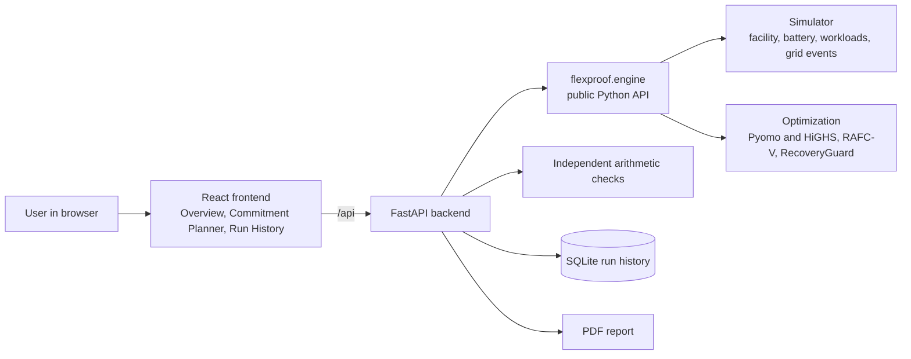

# FlexProof AI

Research engine for datacentre flexibility simulation, reliability-aware commitment, and recovery planning.

**Live demo: https://flexproof-ai.onrender.com** (API docs: https://flexproof-ai.onrender.com/docs)

## About the project

Large AI datacentres use a lot of grid power. When the grid is stressed, a datacentre may be asked to cut its demand for a short time, for example by 5 MW for 60 minutes. FlexProof AI studies how a datacentre can do this reliably without breaking its own limits.

The model scenario, called FP-001, is a 20 MW facility with a battery, critical AI load, fixed facility load, and flexible compute that can be delayed. The system answers three questions:

1. **Commitment:** how many MW can the facility safely promise to the grid, given forecast and meter uncertainty?
2. **Dispatch:** during the event, how should the battery and flexible compute be used to deliver that cut?
3. **Recovery:** after the event, how can the battery recharge and the delayed compute catch up without crossing the 20 MW grid ceiling (RecoveryGuard)?

The main controller, RAFC-V, picks a reliability-calibrated commitment and checks that recovery is possible before promising it. It is compared against a fixed-horizon schedule and a rolling risk-aware MPC controller. All values are modeled assumptions, not measured facility data.

## Architecture



| Part | Folder | What it does |
|---|---|---|
| Simulator | `simulator/` | Facility power balance, battery state of charge, workloads, grid events |
| Controllers | `optimization/`, `baselines/` | RAFC-V, rolling risk-aware MPC, fixed-horizon and rule-based baselines |
| Public engine | `flexproof/` | Stable entry points: `load_scenario`, `evaluate_commitment`, `run_scenario` |
| Evaluation | `evaluation/` | Reproducible experiments, confidence intervals, paired tests |
| Backend | `backend/` | FastAPI: validates scenarios, runs the engine, saves runs, verifies results, makes PDFs |
| Frontend | `frontend/` | React app for planning and viewing runs |
| Contracts | `contracts/` | Units, JSON schemas, example inputs and outputs |

In the live demo, one Docker service on Render runs the backend and also serves the built frontend.

## Results

Evaluated on 5,000 held-out paired scenarios (seeds 400000–404999). Commitment was calibrated on 1,000 separate scenarios and came out at 4.9 MW. Full details are in [docs/RESULTS_AND_LIMITATIONS.md](docs/RESULTS_AND_LIMITATIONS.md).

| Controller | Event and recovery success (95% interval) | Scenarios with shortfall | Workload deadline misses |
|---|---:|---:|---:|
| Fixed horizon | 88.96% (88.06–89.80%) | 552 | 0 |
| Rolling risk-aware MPC | 97.76% (97.31–98.13%) | 112 | 0 |
| Rolling RAFC-V | 97.76% (97.31–98.13%) | 112 | 0 |

- Rolling re-optimization beat the fixed schedule: 440 scenarios succeeded only with rolling control and none the other way (p about 7e-133).
- Recovery was feasible in 5,000 of 5,000 scenarios, with no battery reserve violations.
- **RAFC-V matched risk-aware MPC exactly.** These experiments do not show an extra benefit of RAFC-V over that fair baseline. An earlier, unfair fixed-horizon result was withdrawn.
- RecoveryGuard sensitivity: recovery was feasible in 45 of 48 deterministic cases. The 3 failures had a 4 MWh backlog with an 18 MW ceiling.
- The full-stack prototype passes 82 automated tests, and a live RAFC-V run passes 42 of 42 independent arithmetic checks.

## Limits

This is simulation evidence only. It is not measured facility performance, utility certification, or a claim that RAFC-V is better in general. The prototype has no user accounts and no production database.

## Setup

Requires Python 3.12.

```powershell
py -3.12 -m venv .venv
.\.venv\Scripts\Activate.ps1
python -m pip install -e ".[dev]"
pytest
```

The engine is independent of web APIs and databases. See contracts/units.md and contracts/api_contract.md.
FP-001 is a modeled assumption, not measured data or grid certification. The 17 MW recovery base is an explicit post-event planning baseline for non-flexible demand plus scheduled non-deferred compute. Deferred jobs and battery charging share the 20 MW recovery ceiling.

The stable Python entry points are `flexproof.engine.load_scenario`, `evaluate_commitment`, and `run_scenario`. See docs/integration_guide.md for controller options and contracts/examples for schema-valid input/output fixtures.

## Live demo

- Frontend and backend (one link): https://flexproof-ai.onrender.com
- API docs: https://flexproof-ai.onrender.com/docs
- Health check: https://flexproof-ai.onrender.com/api/health

The website and the API run together as one Docker service on Render's free plan, deployed from `render.yaml`. The root `Dockerfile` builds the React app and the backend serves it. The first request after idle can take about a minute while the service wakes up. Run history is stored on the container disk and resets when the service restarts. This is a demo, not a production deployment.

## Full-stack prototype

Install Python 3.12 and the API/test extras, then start the API:

```powershell
python -m pip install -e ".[api,dev]"
python -m uvicorn backend.app.main:app --reload
```

In another terminal, start the React app:

```powershell
cd frontend
npm ci
npm run dev
```

Open `http://localhost:5173`. The planner validates the scenario, calls the public `flexproof.engine` API, stores the result in SQLite, runs independent arithmetic checks, and offers a PDF report. `GET /api/runs` lists persisted runs. API docs are at `http://127.0.0.1:8000/docs`.

For a containerized run, use `docker compose up --build` and open `http://localhost:8080`. SQLite data persists in the `flexproof-data` volume. Set `FLEXPROOF_DB_PATH` to change the local database path and `VITE_API_BASE_URL` to change the frontend API base.

The result's reliability evidence is calibration evidence only. Independent verification checks returned telemetry arithmetic; it is not facility or utility certification.
See [docs/fullstack_poc.md](docs/fullstack_poc.md) for the data flow, configuration, and scope limits.

Run a smaller four-controller experiment with `python -m evaluation.run_fp001 --calibration-scenarios 200 --test-scenarios 200`. The default runner uses 1,000 calibration and 5,000 held-out scenarios and writes JSON, CSV, and a plot under `results/fp001`.

Run the paired fixed, rolling risk-aware MPC, and rolling RAFC-V evaluation with `python -m evaluation.run_closed_loop --calibration-scenarios 1000 --test-scenarios 100`. It writes per-scenario CSV and aggregate JSON under `results/closed-loop-fp001`. Use the planned 5,000 held-out scenarios for confirmatory reliability estimates.

Run the deterministic RecoveryGuard sensitivity grid with `python -m evaluation.run_recovery_sensitivity`; it writes JSON and CSV under `results/recovery-sensitivity`.
